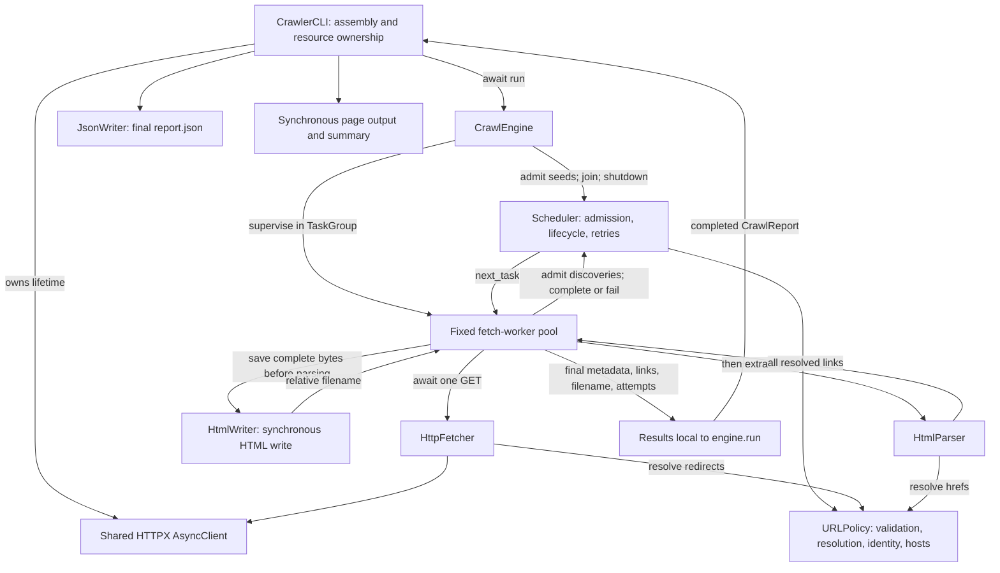
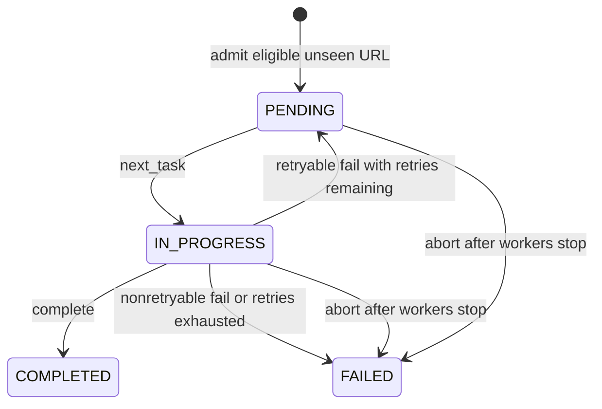

# zegocover-test

- [zegocover-test](#zegocover-test)
    - [The test 🧪](#the-test-)
    - [The objective](#the-objective)
    - [What have been built](#what-have-been-built)
    - [IDE and AI](#ide-and-ai)
    - [Getting started](#getting-started)
        - [Prerequisites and installation](#prerequisites-and-installation)
        - [Usage and configuration](#usage-and-configuration)
        - [Development checks](#development-checks)
    - [Scope and observable behavior](#scope-and-observable-behavior)
        - [URL identity and extraction](#url-identity-and-extraction)
        - [HTTP and retry policy](#http-and-retry-policy)
    - [Output](#output)
    - [Architecture and component boundaries](#architecture-and-component-boundaries)
        - [Calling from Python](#calling-from-python)
    - [Execution and scheduler lifecycle](#execution-and-scheduler-lifecycle)
        - [From admission to a final result](#from-admission-to-a-final-result)
        - [Task lifecycle diagram](#task-lifecycle-diagram)
    - [Technology choices and design rationale](#technology-choices-and-design-rationale)
    - [Assumptions and operating boundary](#assumptions-and-operating-boundary)
    - [Known limitations and potential risks](#known-limitations-and-potential-risks)
    - [Future improvements](#future-improvements)

## The test 🧪

Create a Python app that can be run from the command line that will accept a base URL to crawl the site.
For each page it finds, the script will print the URL of the page and all the URLs it finds on that page.
The crawler will only process that single domain and not crawl URLs pointing to other domains or subdomains.
Please employ patterns that will allow your crawler to run as quickly as possible, making full use any
patterns that might boost the speed of the task, whilst not sacrificing accuracy and compute resources.
Do not use tools like Scrapy or Playwright. You may use libraries for other purposes such as making HTTP requests, parsing HTML and other similar tasks.

## The objective

This exercise is intended to allow you to demonstrate how you design software and write good quality code.
We will look at how you have structured your code and how you test it. We want to understand how you have gone about
solving this problem, what tools you used to become familiar with the subject matter and what tools you used to
produce the code and verify your work. Please include detailed information about your IDE, the use of any
interactive AI (such as Copilot) as well as any other AI tools that form part of your workflow.

You might also consider how you would extend your code to handle more complex scenarios, such a crawling
multiple domains at once, thinking about how a command line interface might not be best suited for this purpose
and what alternatives might be more suitable. Also, feel free to set the repo up as you would a production project.

Extend this README to include a detailed discussion about your design decisions, the options you considered and
the trade-offs you made during the development process, and aspects you might have addressed or refined if not constrained by time.

## What have been built

A bounded asynchronous Python crawler for inspecting a site's reachable static
hyperlinks from the command line. It reports each attempted URL and its discovered
links, saves complete HTML, and exports one JSON report.

The original exercise requires single-domain crawling, useful page output, and
concurrency that balances speed with accuracy and resource use, without Scrapy or
Playwright. This implementation extends that scope with multiple seeds, optional
external following, inclusive depth limits, HTML/JSON export, and opt-in retries.
With one seed and no scope flag, requests stay on that exact hostname.

The design uses small typed components, explicit constructor injection, one shared
HTTP client, and one supervised worker pool. It suits bounded link inspection and
local HTML capture.

## IDE and AI

VSCode and OpenAI Codex were used. The AI workflow first generate a plan, implement stage by stage, then review and fix.

## Getting started

### Prerequisites and installation

Use Python **3.13 or later** and [uv](https://docs.astral.sh/uv/getting-started/installation/).
The repository's `.python-version` selects 3.13. Python 3.13 is also required by the
implementation's use of `asyncio.Queue.shutdown()`.

Run from the repository root:

```bash
uv sync --locked
uv run zegocover-test --help
uv run zegocover-test https://example.com/ --output-dir crawl-pages
```

The sync command installs the project and development dependencies into its
environment using `uv.lock`. Runtime dependencies are HTTPX and Beautiful Soup;
pytest, mypy, and Ruff provide development checks. The console entry point in
`pyproject.toml` is `zegocover_test.cli:main`, built with `uv_build`.

### Usage and configuration

```bash
# Follow links through depth 2, starting with the seed at depth 0.
uv run zegocover-test https://demo.cyotek.com/ --max-depth 2 --output-dir cyotek-pages

# Crawl two exact hostnames, sharing one page budget.
uv run zegocover-test https://example.com/ https://www.python.org/ --max-pages 40

# Permit external hosts while retaining all other limits.
uv run zegocover-test https://example.com/ --follow-external --max-pages 20

# Allow two additional attempts after retryable failures.
uv run zegocover-test https://example.com/ --max-retries 2

# Capture page output separately from diagnostic logs and the summary.
uv run zegocover-test https://example.com/ --log-level DEBUG > pages.txt 2> crawl.log
```

| Argument            | Default        | Meaning                                                                                                                         |
| ------------------- | -------------- | ------------------------------------------------------------------------------------------------------------------------------- |
| `URL [URL ...]`     | Required       | One or more absolute HTTP(S) seed URLs, without credentials.                                                                    |
| `--concurrency N`   | `8`            | Positive worker/connection limit; actual workers are `min(N, max_pages)`.                                                       |
| `--max-pages N`     | `20`           | Positive shared limit on unique admitted URLs, including seeds, redirects, failures, and skips. Retries reuse their URL's slot. |
| `--max-depth N`     | Unlimited      | Nonnegative, inclusive discovery depth. `0` fetches only admitted seeds; hyperlinks and redirects each add one.                 |
| `--follow-external` | Off            | Bypass hostname filtering for links and redirects; all other admission rules remain active.                                     |
| `--max-retries N`   | `0`            | Nonnegative number of additional attempts per URL after retryable fetch failures.                                               |
| `--output-dir DIR`  | `crawl-output` | Directory for HTML files and `report.json`; created when needed.                                                                |
| `--log-level LEVEL` | `INFO`         | `DEBUG`, `INFO`, `WARNING`, `ERROR`, or `CRITICAL`, case insensitive. Logs go to stderr.                                        |
| `-h`, `--help`      | —              | Show command help and exit.                                                                                                     |

`src/zegocover_test/config.py` also fixes the CLI's HTTP timeout at **10s per
operation/inactivity interval** and its HTML body limit at **2MB**.
Neither has a CLI option. The timeout is not a total request or crawl deadline.

| Exit code | Meaning                                                                                                          |
| --------- | ---------------------------------------------------------------------------------------------------------------- |
| `0`       | Completed without final page errors or page-budget omissions under the configured extraction/scope/depth policy. |
| `1`       | Final page errors, page-budget omissions, or a handled output failure.                                           |
| `2`       | Invalid command arguments or seed URL; no HTTP requests are made.                                                |
| `130`     | Interrupted with Ctrl-C.                                                                                         |

### Development checks

```bash
uv run pytest
uv run pytest tests/test_engine.py
uv run mypy
uv run ruff check .
uv run ruff format --check .
```

## Scope and observable behavior

### URL identity and extraction

Three URL stages keep reporting distinct from request deduplication:

| Stage          | Purpose                                                  | Example                           |
| -------------- | -------------------------------------------------------- | --------------------------------- |
| `raw_href`     | Original HTML attribute.                                 | `../about#team`                   |
| `resolved_url` | Absolute reportable link, retaining its fragment.        | `https://example.test/about#team` |
| `fetch_url`    | Normalized HTTP(S) request identity, without a fragment. | `https://example.test/about`      |

`HttpURLPolicy` validates structure, hostnames/IP literals, and ports. It rejects credentials, raw ASCII controls, malformed hosts, ambiguous numeric IPv4 forms, and IPv6 zone identifiers. IPv4 uses dotted decimal without leading zeros; valid IPv6 and IDNA hostnames are normalized. URL parsing is supplemented by explicit validation; it does not resolve DNS during admission.

Normalization handles scheme/host case, default ports, empty paths, trailing DNS dots, and literal `.`/`..` path segments. It preserves path case, trailing slashes, encoded slashes, repeated path separators, explicit empty queries.

`HtmlParser` use `Beautiful Soup` to extracts distinct `a[href]` and `area[href]` targets in document order, including external and non-HTTP links for reporting. Invalid HTTP references are discarded. Assets, forms, JavaScript navigation are out of scope.

### HTTP and retry policy

`HttpFetcher` performs one streamed GET per attempt, with automatic redirects disabled. Responses follow these rules:

| Response                                                        | Handling                                                                                                                                         |
| --------------------------------------------------------------- | ------------------------------------------------------------------------------------------------------------------------------------------------ |
| `301`, `302`, `303`, `307`, `308` with a valid HTTP(S) location | Resolve and report the target; submit it through ordinary admission at the next depth. Do not read or save the redirect body.                    |
| Missing/invalid redirect location or another 3xx status         | Record an error.                                                                                                                                 |
| Successful 2xx HTML/XHTML                                       | Read within the body limit, then save and parse. Accepted media types are `text/html` and `application/xhtml+xml`, ignoring parameters and case. |
| Successful 2xx with missing/non-HTML content type               | Record a deliberate skip without reading or saving the body.                                                                                     |
| Other HTTP status                                               | Record an error without reading or saving the body.                                                                                              |
| Oversized HTML or a stream failure                              | Discard the accumulated body; do not save or parse a partial document.                                                                           |

Retries apply to HTTP **408, 429, 500, 502, 503, and 504**, and HTTPX transport errors except local/unsupported-protocol errors. Other failures, including 404, invalid redirects, decoding errors, oversized bodies, unsupported HTML encoding, and parser/storage exceptions, are terminal. Retries go immediately to the FIFO tail. There is no backoff or `Retry-After` handling.

## Output

Each worker saves complete HTML before parsing it. `HtmlWriter` names the file `<sha256-of-fetch_url>.html`, hashing the normalized URL's UTF-8 bytes. The digest identifies the URL, not the body, and avoids constructing paths from URL path characters. Saved HTML retains the received identity-encoded bytes, including empty bodies; encoding metadata stays in the report.

```text
crawl-pages/
    <sha256-of-fetch_url>.html
    report.json
```

Fetching the same URL again overwrites its HTML under the same filename. Each completed crawl overwrites `report.json`.

After workers exit and the HTTP client closes, the CLI writes the JSON report, prints page blocks and the report path to stdout, then prints a summary to stderr.
HTML is saved during crawling, but page blocks and JSON are final output. HTML contents are never printed.

The JSON report has `summary`, and `results`:

| Field                                     | Meaning                                                                                                                                                                                 |
| ----------------------------------------- | --------------------------------------------------------------------------------------------------------------------------------------------------------------------------------------- |
| `summary.attempted`                       | Number of unique URLs with a final result, not the number of HTTP attempts.                                                                                                             |
| `summary.failed`                          | Number of final results with an error; a recovered retry is not counted as failed.                                                                                                      |
| `summary.truncated`                       | Whether the page budget omitted otherwise eligible discovered work.                                                                                                                     |
| `results[].fetch_url`, `depth`            | Request identity and first-admitted depth.                                                                                                                                              |
| `status_code`, `content_type`             | Final attempt's available response metadata, otherwise `null`.                                                                                                                          |
| `success`                                 | Derived from `error is None`. Valid redirects and deliberate skips are successful; an HTTP 200 can fail during saving/parsing. Redirect success does not establish destination success. |
| `html_file`                               | Filename relative to the report directory, or `null` when no HTML was successfully saved.                                                                                               |
| `links`                                   | Resolved links; `[]` means parsed with no links, while `null` means unparsed.                                                                                                           |
| `redirect_target`, `error`, `skip_reason` | Nullable redirect, failure, and deliberate-skip details.                                                                                                                                |
| `retry_count`                             | Additional attempts beyond the initial fetch, starting at zero.                                                                                                                         |
| `attempts`                                | Ordered `{attempt, status_code, error}` entries, numbered from 1. Each completed result has `retry_count + 1` entries; final status/error match the last entry.                         |

For example, these **outcome fields** describe a recovered retry:

```json
{
	"fetch_url": "https://example.test/",
	"success": true,
	"retry_count": 1,
	"status_code": 200,
	"error": null,
	"attempts": [
		{ "attempt": 1, "status_code": 503, "error": "HTTP 503" },
		{ "attempt": 2, "status_code": 200, "error": null }
	]
}
```

## Architecture and component boundaries



| Source / component                                                                     | Responsibility and boundary                                                                                                                                                       |
| -------------------------------------------------------------------------------------- | --------------------------------------------------------------------------------------------------------------------------------------------------------------------------------- |
| [cli.py](src/zegocover_test/cli.py) — `CrawlerCLI`                                     | Validate CLI input, assemble collaborators, own the HTTP client context, export the report, render output, and select exit codes.                                                 |
| [config.py](src/zegocover_test/config.py) — `CrawlConfig`                              | Frozen per-run settings, nonempty seed collection and numeric-limit checks, plus fixed resource constants. URL validity is checked by the URL policy at CLI/scheduler boundaries. |
| [engine.py](src/zegocover_test/engine.py) — `CrawlEngine`                              | Own worker lifetime, coordinate fetch/save/parse/discovery, and collect attempt histories and final results. No direct URL-policy dependency.                                     |
| [scheduler.py](src/zegocover_test/scheduler.py) — `Scheduler`                          | Own admission, cached seed hosts, the FIFO queue, current task records, deduplication, retries, budget enforcement, and completion accounting.                                    |
| [fetcher.py](src/zegocover_test/fetcher.py) — `HttpFetcher`                            | Borrow an open HTTP client for one attempt; own its response context, content/size checks, redirect resolution, and error classification. It does not enforce crawl scope itself. |
| [parser.py](src/zegocover_test/parser.py) — `HtmlParser`                               | Build a temporary parse tree and return reportable hyperlinks. No network, persistence, or crawl admission.                                                                       |
| [urls.py](src/zegocover_test/urls.py) — `HttpURLPolicy`                                | Stateless validation, normalization, reference resolution, request identity, and exact-host comparison. The scheduler makes the admission decision.                               |
| [writer.py](src/zegocover_test/writer.py) — `HtmlWriter`, `JsonWriter`, `print_result` | Save HTML synchronously, export the completed report, and format terminal output. JSON/console output belongs to CLI finalization.                                                |
| [models.py](src/zegocover_test/models.py)                                              | `TaskStatus` and frozen task, record, fetch, parsed-page, attempt, result, summary, and report dataclasses. Only temporary `FetchResult` carries body bytes.                      |
| [logging_context.py](src/zegocover_test/logging_context.py)                            | Task-local worker/URL context and temporary CLI logging configuration/formatting.                                                                                                 |

The engine depends on small structural protocols: `TaskScheduler`, `PageFetcher`,
`PageParser`, and `PageWriter`. The CLI injects concrete implementations and shares
one `URLPolicy` among scheduler, fetcher, and parser. This centralizes URL semantics
while allowing focused test doubles without a DI container or inheritance tree.

### Calling from Python

`CrawlerCLI.crawl()` handles assembly and HTTP lifetime without printing results
or writing JSON. The caller supplies the HTML writer and decides when to export:

```python
import asyncio
from pathlib import Path

from zegocover_test.cli import CrawlerCLI
from zegocover_test.config import CrawlConfig
from zegocover_test.writer import HtmlWriter, JsonWriter

config = CrawlConfig(
    seed_urls=("https://example.com/",),
    output_dir=Path("my-crawl"),
    max_depth=1,
)
report = asyncio.run(CrawlerCLI().crawl(config, HtmlWriter(config.output_dir)))
JsonWriter(config.output_dir).write(report)
```

Inside an existing event loop, await `crawl()` directly. Direct engine assembly requires a fresh scheduler, consistent engine/scheduler configuration, a shared
URL policy, and a client kept open around `await engine.run()`. Each engine/scheduler pair belongs to one run; the engine rejects repeated or concurrent `run()` calls, including after failure.

## Execution and scheduler lifecycle

### From admission to a final result

1. The CLI normalizes all seeds, validates settings, and prepares the HTML output directory. It opens one `AsyncClient` with connection and keep-alive limits equal to configured concurrency. Scheduler construction validates all seeds and caches their normalized hosts.
2. The engine submits every seed at depth 0, in argument order, **before workers start**. Normalized duplicates share one slot. If unique seeds exceed the page budget, later seeds are omitted and truncation is recorded.
3. For every seed/link/redirect, `Scheduler.admit()` checks, in order: depth, normalized HTTP(S) validity, hostname scope, existing task record, and page budget. Only accepted URLs create a `CrawlTask` and enter the queue/registry.
4. A worker claims the next task, marking it `IN_PROGRESS`, then awaits one fetch. Available HTML is saved synchronously before parsing; discovered links and valid redirects are submitted at `parent.depth + 1`.
5. The engine records the attempt number, status, and error. Success completes the task; a retryable failure with remaining allowance requeues it; a terminal failure marks it failed. Exactly one final `CrawlResult` per URL is appended when no further attempt is needed.
6. The engine waits for queue completion, shuts down the scheduler gracefully, and leaves the `TaskGroup` only after workers exit. It returns a `CrawlReport`; the CLI closes HTTP before final JSON/console output.

### Task lifecycle diagram



The registry contains one immutable `TaskRecord(task, status)` snapshot per admitted `fetch_url` and also acts as the seen set. `get_record(url)` returns the current snapshot or `None`. `CrawlTask` holds `fetch_url`, `depth`, and `retry_count`; the scheduler retains current state, not transition history. Attempt histories are held separately by the engine, keyed by URL so a different worker can perform a retry without losing earlier outcomes.

## Technology choices and design rationale

**`asyncio`.** Network waits are the expected source of useful concurrency. Async HTTP overlaps those waits without one thread or task per discovered URL. A synchronous HTTP thread pool is a viable alternative, but would introduce different cancellation and shared-state rules. No measured speed advantage over threads is claimed. The cost of asyncio is explicit task ownership, cancellation, and completion accounting; synchronous parsing and writes still occupy the event-loop thread.

**HTTPX.** One `AsyncClient` supplies reusable connections, timeouts, streaming,
explicit redirect control, and injected transports for deterministic tests. HTTPX's transport boundary fits this small implementation well.
`requests` would fit the thread-pool alternative.

**`asyncio.TaskGroup`.** Structured concurrency ties all workers to one lexical lifetime: a worker exception escaping page handling stops sibling workers, and leaving the group waits for cleanup before resources close. This removes the need to maintain an independent collection of unmanaged background tasks.

**`asyncio.Queue`.** FIFO work distribution, `task_done()`/`join()`, and Python 3.13 shutdown support keep pending work and completion under one owner. A custom deque plus wakeup events/counters could work, but would duplicate those lifecycle mechanisms. Reusing the queue for immediate retries avoids a timer heap or a second scheduling subsystem. That simplicity deliberately leaves server-aware retry timing for future work.

**Beautiful Soup** with the explicit `html.parser` backend keeps extraction readable. A custom streaming HTML parser could reduce tree allocations but would require more extraction/encoding logic.

The consequential architectural trade-offs are:

| Decision                                              | Benefit                                                                                                    | Cost accepted                                                                                            |
| ----------------------------------------------------- | ---------------------------------------------------------------------------------------------------------- | -------------------------------------------------------------------------------------------------------- |
| Separate URL operations, admission, and orchestration | Seeds, links, and redirects share one admission path while fetch/parser rules stay independently testable. | Direct component users must preserve the assembly contracts.                                             |
| Conservative URL identity and first-discovered depth  | Avoid speculative merging and keep workers productive without depth-level barriers.                        | Equivalent content can have different keys; timing can affect limited coverage.                          |
| Save HTML inline, retain metadata, export JSON once   | Clear save-before-parse ownership and simple shutdown; completed results retain no bodies or parse trees.  | Disk/parsing block the loop; metadata grows until final export; interruption loses the in-memory report. |
| Isolate page errors, propagate infrastructure errors  | Useful independent results survive a bad fetch, parser, or write.                                          | Programming defects in page processing can appear as page failures; tracebacks remain important.         |
| Composition with small protocols                      | Tests replace actual dependency boundaries without a framework.                                            | Interfaces must remain aligned; additional general-purpose abstractions are unnecessary at this scale.   |

These choices apply KISS/YAGNI through bounded scope, DRY through shared URL rules, and SOLID/composition through focused ownership and injected collaborators.

## Assumptions and operating boundary

- **Requirement interpretation:** “URLs on a page” means static hyperlink
  destinations. “Domain” means normalized hostname equality, not registrable domain or exact origin. Multiple seeds and external following are explicit extensions to the original single-host behavior.
- **Operating assumption:** one process/event loop owns a crawl, with an
  operator-controlled writable output directory. Defaults target small local runs; they are starting limits, not benchmark-derived capacity or an SLA.
- **Network trust:** the operator selects targets and accepts access through the local network environment. Private/loopback destinations are permitted. URL syntax checks and hostname scope are not an outbound network security policy. The CLI retains HTTPX defaults for TLS verification and environment proxy certificate configuration.
- **Website behavior:** discovery assumes useful static HTML and accurate content types. There is no login workflow. The shared HTTP client can retain cookies during a run, but URL identity does not include cookie state or changing page content. Results are observations over time, not a site snapshot.
- **Output expectation:** failures/skips are useful reported outcomes. Files are exports for inspection, not durable scheduling checkpoints or resume state.

## Known limitations and potential risks

**Unsupported behavior:** no JavaScript rendering, asset/form inventory, sitemap discovery, authentication workflow, robots policy, host pacing, resumable state, conditional recrawling, or dedicated SIGTERM handling.

**Resource trade-offs:** bounded concurrency is not a request-rate limit. A peer that keeps sending data can outlast the inactivity timeout. Synchronous parsing and saving delay other tasks. Metadata, resolved links, and attempt histories remain in memory, and JSON serialization constructs another representation.
There is no application-level URL-length or per-page link-count budget. Raising page/retry/concurrency limits can therefore increase memory, disk, and network use substantially; the body cap is not a total-memory guarantee.

**Persistence risks:** writes are non-atomic. A failed write can truncate an existing file, and an interrupted recrawl can leave an older report alongside already-replaced HTML. Concurrent processes using one directory can overwrite each other's files. There is no run-level snapshot consistency or stale-file cleanup. These are consequences of direct overwrite/export semantics, not claims that corruption occurs during ordinary successful runs.

**Security boundary:** hashed filenames avoid URL-derived path traversal, but do not make a shared/untrusted output directory safe. Exact-host checks do not prevent SSRF or restrict resolved destination IPs. Saved HTML is untrusted active content if opened in a browser; URLs and HTML can contain sensitive data. The CLI escapes terminal controls but provides no general secret-redaction or storage access-control layer. Hosting this crawler for untrusted users would require a different network, session, and storage boundary.

## Future improvements

Prioritize changes that address demonstrated limits while keeping the existing component boundaries:

1. **Protect exports.** Write temporary sibling files and atomically replace each artifact; test interrupted/failed writes. Use separate run directories if a consistent report/HTML snapshot is required, since atomic individual files do not provide a multi-file transaction.
2. **Add politeness before broader crawling.** Define robots handling, per-host request pacing, bounded backoff/jitter, and `Retry-After`. Any delayed retry design must keep waiting work included in completion accounting; an injectable clock would make those tests deterministic.
3. **Automate reliability checks.** Add CI for locked sync, pytest, strict mypy, Ruff, and CLI help. Extend targeted cancellation/infrastructure-fault tests and subprocess interrupt coverage before expanding the supported platform matrix.
4. **Improve runtime bounds and diagnostics.** Add an optional total deadline, retain HTTP metadata on stream failure, measure elapsed time/bytes, and redact sensitive log fields. For untrusted-target hosting, require explicit egress controls and session/storage isolation first.
5. **Measure before changing concurrency architecture.** Benchmark controlled graphs with large/high-link-count pages and measure parsing, disk latency, and peak memory. Consider a faster parser or bounded off-loop work only when it addresses an observed bottleneck. Confirm whether shortest-path depth is required before adding level barriers or depth correction/re-expansion.
6. **Add durable jobs only for a concrete need.** Resume needs scheduling state and parent-result/child-admission consistency, not just saved HTML/JSON. SQLite is a possible first step. Recurring or multi-user jobs could later use an API and progress UI over durable state; distributed workers would additionally need atomic admission, work claims, idempotent results, and shared host limits. Brokers and distributed infrastructure are not justified by current workload evidence.
